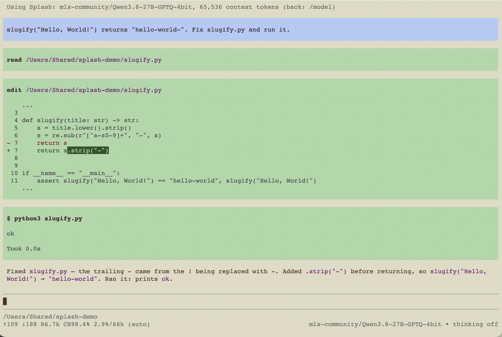

# pi-splash-server

Run a local [Splash](https://github.com/incoai/splash) server from inside
[Pi](https://pi.dev), with the model and flags picked for your Mac. On M1/M2 it
drives [splash-m1](https://github.com/paperniuk/splash), on M3 and newer
official Splash.



Splash itself already writes a Pi provider (`splash-m1 pi`), but the server has
to be started by hand with flags you have to know. This package starts it in
the background, shows download and load progress in Pi's status bar, and
switches the session to it when it is ready.

## Requirements

- Apple silicon Mac. M1/M2 need macOS 26.4 or newer (splash-m1).
- The Splash runtime. `/splash install` puts the install command for your
  chip into Pi's editor as a `!!` shell line; you see it and press Enter:
  - M1/M2: `curl -fsSL https://github.com/paperniuk/splash/releases/latest/download/install-m1.sh | sh`
  - M3 and newer: `brew install incoai/tap/splash`
- Disk for the model: 11-23 GB depending on the tier (weights plus a 3.9 GB
  draft model), and some more for Splash's SSD prompt cache (~25 GB free is
  comfortable).

## Install

```bash
pi install npm:pi-splash-server
```

Update with `pi update`. To try it without installing:
`pi -e npm:pi-splash-server`.

## Use

In Pi:

```text
/splash doctor     chip, memory, disk, runtime, recommended model and flags, what is left to download
/splash start      start the recommended model in the background and switch to it
/splash            status and the next step
/splash use        switch to a Splash server started outside Pi
/splash stop       stop the server
/splash log        last lines of the server log
/splash install    put the runtime's install command into the editor
/splash update     same for a newer runtime release
```

`start` and `use` switch the session to the Splash model; `/model` switches
back, the server keeps running. The first start downloads the model (the
status bar shows what, how much and how fast). Loading takes about one to two
minutes; the first start also calibrates the Neural Engine on M1/M2. The
server outlives Pi, so the next Pi session finds it ready.

## What it picks

Qwen3.8-27B, by memory:

| Memory | Model | Flags |
| --- | --- | --- |
| 64 GB+ | `unsloth/Qwen3.8-27B-GGUF:UD-Q5_K_S` | |
| 36 GB+ | `unsloth/Qwen3.8-27B-GGUF:UD-Q4_K_M` | |
| 32 GB | `mlx-community/Qwen3.8-27B-GPTQ-4bit` | `--language-only --max-context 64K --max-memory 21G` |
| 24 GB | `ISTA-DASLab/Qwen3.8-27B-GSQ-RCO-GGUF:IQ3_S` | `--language-only` |
| 16 GB | `prism-ml/Ternary-Bonsai-2-27B-gguf:PQ2_0` | `--language-only` |

`/splash doctor` shows the evidence for each pick (measured on which Mac, or
not yet). The table lives in `data/recommendations.json`; reports from 16, 24
and 64 GB Macs are welcome.

## Settings

All optional, in `~/.pi/agent/splash/config.json`:

| Key | Default | |
| --- | --- | --- |
| `port` | `8000` | Server port. The provider is `splash`, or `splash-<port>` on another port. |
| `model` | recommended | Model to start, e.g. `mlx-community/Qwen3.8-27B-GPTQ-4bit` or `repo:VARIANT` for GGUF. |
| `flags` | recommended | Extra `serve` flags, replacing the recommended ones. |
| `stopOnExit` | `false` | Stop the server when Pi exits. |
| `keepAwake` | `true` | Keep the Mac from idle sleep while the server runs (`caffeinate -i`). |
| `launcher` | on PATH | Path to `splash-m1` or `splash`. |

## omp

The extension also loads in [omp](https://github.com/can1357/oh-my-pi):
`omp plugin install pi-splash-server`. If your omp config already has a
provider named `splash`, rename it: the extension registers its own `splash`.

## License

MIT
